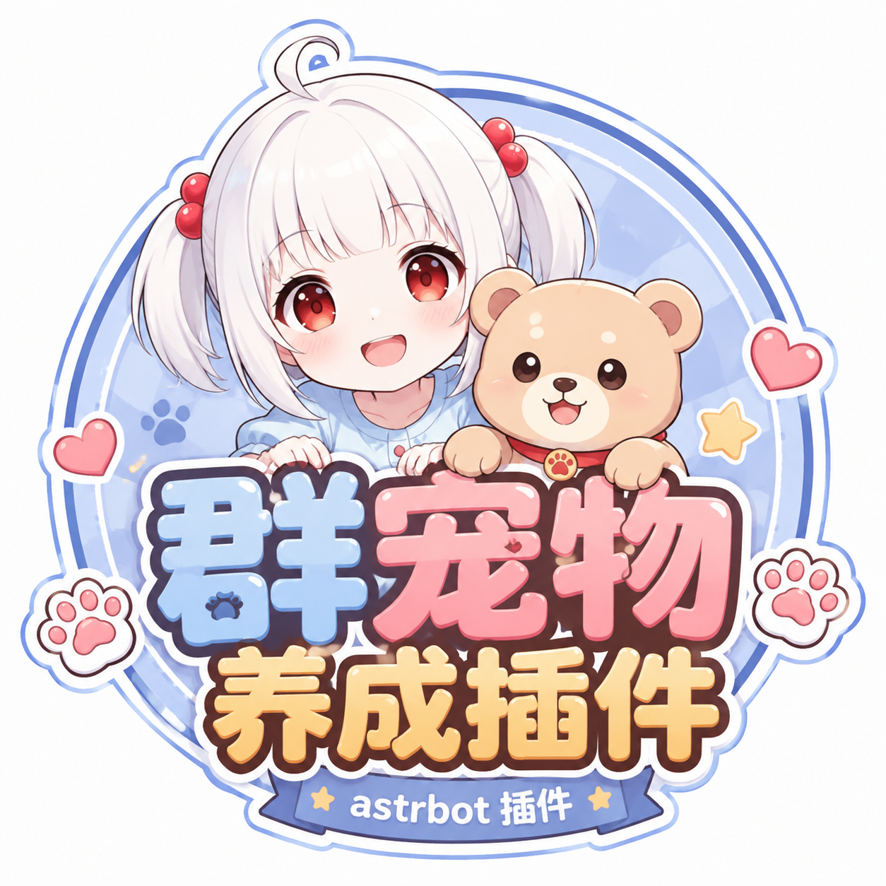

# astrbot_plugin_group_pet 群宠物养成



> ⚠️ **本插件仍在开发中**，功能与数值还会继续调整，可能存在 bug。
> 遇到问题欢迎提 [Issue](https://github.com/xiaowan138/astrbot_plugin_group_pet/issues)。

一个纯本地、零外部依赖的 AstrBot 养成类互动插件：每个用户可以领养一只随机品种的宠物，
通过喂食、玩耍、打工、冒险照顾它、赚金币、升等级。宠物会随时间慢慢变饿、变无聊，
**饿太久会真的离家出走**——快叫群友们起来喂宠物吧。

## 功能特性

- 🎲 **随机品种**：仓鼠 / 柴犬 / 布偶猫 / 兔子 / 小狐狸 / 熊猫，每个品种有专属特性加成
  （柴犬打工 +20%、布偶猫玩耍 +30%、仓鼠饿得慢、熊猫心态稳、兔子冒险捡钱多、小狐狸冒险经验多）
- 📊 **状态面板**：经验 / 饱食度 / 心情 / 钱包，进度条可视化
- 🍚 **喂食**：花金币恢复饱食度，攒经验
- 🎾 **玩耍**：恢复心情，攒经验
- 💼 **打工**：赚金币（要吃饱、有心情才肯干活）
- 🗺️ **冒险**：随机事件——小收获 / 大发现 / 遭遇危险 / 空手而归 / 稀有宝藏
- 🏆 **排行榜**：群聊内自动按群统计，私聊为全局榜
- ⏳ **冷却与衰减**：所有行为有冷却；后台定时衰减饱食度与心情，饥饿状态持续超时会离家出走
- 💾 **数据本地持久化**：SQLite（WAL），存于 `data/plugin_data/astrbot_plugin_group_pet/`

## 指令

默认需要带唤醒前缀（AstrBot 默认为 `/`），群聊里也可以 `@机器人`。

| 指令 | 说明 |
| --- | --- |
| `宠物` / `我的宠物` | 查看宠物状态；没有宠物时显示领养引导 |
| `宠物领养 <名字>` | 领养一只随机品种宠物（名字 1~8 字），附赠 💰30 新手礼包 |
| `宠物喂食` / `喂宠物` | 花金币喂食，饱食度 +35，冷却 60 秒 |
| `宠物玩耍` / `逗宠物` | 心情 +30（受品种加成），冷却 5 分钟 |
| `宠物打工` | 赚金币，冷却 10 分钟，需饱食 ≥15 且心情 ≥15 |
| `宠物冒险` | 随机事件，冷却 15 分钟，需饱食 ≥20 |
| `宠物排行` / `宠物榜` | 等级排行（群聊为群排行，私聊为全局） |
| `宠物放生 确认` | 放生宠物，需二次确认 |

## 安装

1. 将 `astrbot_plugin_group_pet` 文件夹（或 zip）放入 AstrBot 的 `data/plugins/` 目录，
   或在 WebUI「插件市场 → 从文件/URL 安装」上传。
2. 重载插件即可，无需任何额外依赖（`requirements.txt` 为空）。
3. 在 WebUI 插件配置页可调整经济与衰减参数。

## 配置项

| 配置 | 默认 | 说明 |
| --- | --- | --- |
| feed_cost | 5 | 喂食一次消耗金币 |
| feed_cooldown_s | 60 | 喂食冷却（秒） |
| play_cooldown_min | 5 | 玩耍冷却（分钟） |
| work_cooldown_min | 10 | 打工冷却（分钟） |
| adventure_cooldown_min | 15 | 冒险冷却（分钟） |
| work_reward_min / max | 10 / 25 | 打工收益区间 |
| levelup_coin_bonus | 20 | 升级奖励金币（升级所需经验 = 等级 × 50） |
| decay_interval_min | 30 | 后台衰减间隔（分钟） |
| decay_hunger | 2 | 每次衰减掉的饱食度（默认约 20 小时从 80 饿到 0） |
| runaway_hours | 72 | 饥饿持续多少小时后离家出走；设 0 关闭 |

## 数据与目录结构

```
astrbot_plugin_group_pet/
├── main.py            # 插件主体（指令、玩法、后台衰减任务）
├── pet_store.py       # SQLite 持久层（无 AstrBot 依赖，可独立测试）
├── metadata.yaml
├── _conf_schema.json
└── README.md
```

数据库位于 `data/plugin_data/astrbot_plugin_group_pet/pets.db`，删除该文件即可全部重置。

## 已知设计取舍

- 衰减由后台定时任务驱动，机器人关机期间游戏时间暂停。
- 「离家出走」在主人与宠物下次互动时结算并发送告别文案。
- 排行榜中主人一栏直接显示 QQ 号（仅自己的条目显示昵称），避免额外平台 API 依赖。
